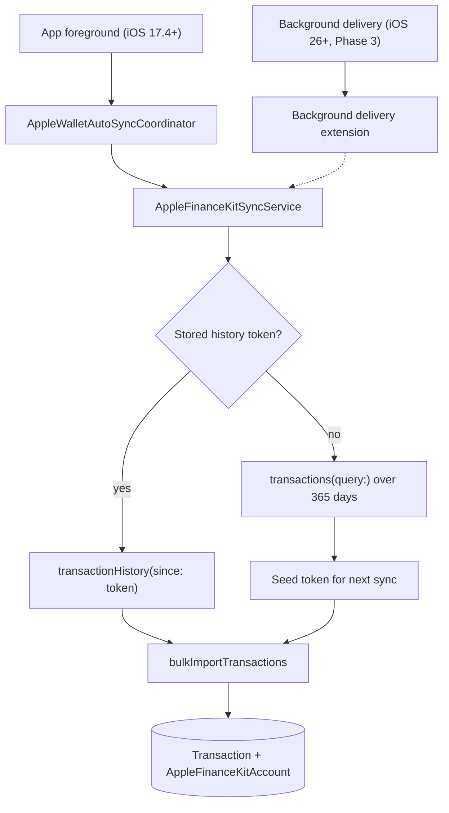

# Apple Wallet Background Sync

## Status

Draft. Created 2026-07-25 while implementing automatic Apple Wallet refresh. Supersedes the "Background sync: out of scope for v1" decision in [../../complete/apple-wallet/spec.md](../../complete/apple-wallet/spec.md).

Phases 1 and 2 below are implemented. Phase 3 is blocked on Apple Developer portal work that cannot be done from a code change.

## Goal

Apple Wallet accounts drifted days behind while Plaid accounts stayed current, because Apple Wallet had no automatic sync at all — every `lastSyncedAt` write came from a user tapping Sync.

Plaid stays fresh through server-side crons (`/api/cron/scheduled-balance-sync`, `/api/cron/scheduled-transaction-fallback` in [apps/api/vercel.json](../../../apps/api/vercel.json)) because our server holds an access token. FinanceKit has no server API — Apple states the data "is retrieved directly from the on-device data store and never seen by Apple" — so every Apple Wallet sync must originate on the iPhone.

Success means:

- A user who opens the app at least daily never sees an Apple Wallet sync age above roughly 12 hours.
- A routine sync uploads only what changed, instead of re-POSTing a 365-day window.
- Deletions in Apple Wallet propagate to Moat instead of leaving orphaned transactions.

## Product Context

The Financial Profile screen shows every connection's sync age side by side. An Apple Card reading "Synced 4 days ago" next to a bank reading "Synced 20 hours ago" reads as a broken integration, and stale Apple Card balances silently corrupt net worth, spending insights, and cash-flow forecasts.

## Cost Model

Worth stating explicitly, because it differs from Plaid.

| | Plaid | FinanceKit |
|---|---|---|
| Vendor cost per read | `/accounts/get` and `/transactions/sync` are `cached_or_included`; `/accounts/balance/get` is `billable_per_request` | None. Reads are on-device, offline, and free |
| Cheap vs expensive path | Cached endpoints vs billable realtime endpoint | Change stream (`transactionHistory(since:)`) vs full snapshot query |
| What we actually pay | Plaid invoice | Our own Vercel function time and Neon writes, plus device battery |

FinanceKit has no billable tier, so there is no vendor reason to avoid syncing often. The reason to sync incrementally is our own cost: before this work, every resync fetched 365 days and POSTed all of it to `bulkImportTransactions`, which re-deduped, re-categorized via MCC mapping, and re-ran the rules engine over data we already had.

## Current Repo Context

### Existing building blocks

| Asset | Location | Notes |
|-------|----------|-------|
| FinanceKit reads | [apps/ios/Moat/Features/AppleWallet/Services/apple-finance-kit-service.swift](../../../apps/ios/Moat/Features/AppleWallet/Services/apple-finance-kit-service.swift) | Only place raw FinanceKit types are allowed |
| Sync orchestration | [apps/ios/Moat/Features/AppleWallet/Services/apple-finance-kit-sync-service.swift](../../../apps/ios/Moat/Features/AppleWallet/Services/apple-finance-kit-sync-service.swift) | Upserts accounts, then syncs transactions per account |
| Foreground trigger | [apps/ios/Moat/Features/AppleWallet/Services/apple-wallet-auto-sync-coordinator.swift](../../../apps/ios/Moat/Features/AppleWallet/Services/apple-wallet-auto-sync-coordinator.swift) | Wired from `scenePhase` in [app-shell-view.swift](../../../apps/ios/Moat/App/app-shell-view.swift) |
| History token persistence | [apps/ios/Moat/Features/AppleWallet/Services/apple-finance-kit-history-token-store.swift](../../../apps/ios/Moat/Features/AppleWallet/Services/apple-finance-kit-history-token-store.swift) | Keychain, optional access group |
| Shared container config | [apps/ios/Moat/Features/AppleWallet/Services/apple-wallet-shared-container.swift](../../../apps/ios/Moat/Features/AppleWallet/Services/apple-wallet-shared-container.swift) | Reads App Group / Keychain access group from Info.plist |
| Background delivery wrapper | [apps/ios/Moat/Features/AppleWallet/Services/apple-finance-kit-background-delivery.swift](../../../apps/ios/Moat/Features/AppleWallet/Services/apple-finance-kit-background-delivery.swift) | No-op until an App Group exists |
| Import endpoint | [apps/api/src/server/services/apple-financekit-import.service.ts](../../../apps/api/src/server/services/apple-financekit-import.service.ts) | Dedupe, MCC categorization, rules, soft delete |
| Sync rate limits | [apps/api/src/server/services/apple-financekit-sync-rate-limit.service.ts](../../../apps/api/src/server/services/apple-financekit-sync-rate-limit.service.ts) | Per-user fixed window |

### Constraints

- FinanceKit query APIs require iOS 17.4+; background delivery requires **iOS 26+**. The app's `IPHONEOS_DEPLOYMENT_TARGET` is 16.0, so all FinanceKit code stays behind availability guards.
- The FinanceKit managed entitlement is granted **per bundle ID**. An extension is a separate bundle ID and needs its own approved request.
- Adding `com.apple.security.application-groups` to entitlements before the App Group exists in the developer portal breaks code signing, so those keys are deliberately absent from [MoatApp.entitlements](../../../apps/ios/Moat/SupportingFiles/MoatApp.entitlements) and [MoatRelease.entitlements](../../../apps/ios/Moat/MoatRelease.entitlements).

## Architecture



### Import endpoint contract change

`POST /api/v1/appleFinancekit/bulkImportTransactions` gained an optional field:

```ts
deletedExternalTransactionIds: z.array(z.string().min(1)).max(5000).optional()
```

These are raw provider transaction IDs; the service prefixes them with `APPLE_FINANCEKIT:` before matching. Rows are soft-deleted via `removedAt`, mirroring the Plaid removal path in [apps/api/src/server/plaid/syncTransactions.ts](../../../apps/api/src/server/plaid/syncTransactions.ts). The response gained `removedCount`.

Deletions are applied before upserts, so a transaction that is both deleted and re-inserted in one batch ends up present (the upsert path clears `removedAt`).

## Implementation Plan

### Phase 1 — Foreground staleness sync (implemented)

1. `AppleWalletAutoSyncCoordinator.syncIfStale(isDemoMode:)` runs on app launch and on `scenePhase == .active`.
2. Guard order is deliberately cheapest-first: demo mode, OS support, in-flight check, and a 30-minute local attempt floor all resolve with no network call; then an on-device FinanceKit authorization check; only then `getStatus()`.
3. Staleness threshold is 12 hours, matching `SCHEDULED_BALANCE_STALE_MS` in [plaid-connection-sync.service.ts](../../../apps/api/src/server/services/plaid-connection-sync.service.ts), so Apple Wallet and Plaid go stale on the same clock.
4. The attempt timestamp is recorded before the sync runs, so a failing sync throttles itself instead of retrying on every foreground.
5. Failures log through `FinanceKitDiagnostics` only. Auto sync never raises UI; manual Sync stays the loud path.

**Acceptance criteria:** a connected user who backgrounds and reopens the app after 12+ hours sees the Apple Wallet sync label refresh without tapping anything, and a user who never connected Apple Wallet makes no extra network requests.

### Phase 2 — Incremental deltas (implemented)

1. `fetchTransactionChanges(for:since:)` wraps `store.transactionHistory(forAccountID:since:isMonitoring: false)` and returns inserted plus updated rows, deleted IDs, and the newest `HistoryToken` serialized to `Data`.
2. Tokens are stored per `externalAccountId` in the Keychain. FinanceKit types never cross the service boundary — the protocol traffics in `Data`.
3. A missing or rejected token falls back to the bounded 365-day snapshot, then seeds a token by draining the change stream and discarding rows. That drain is on-device, so it costs no API calls.
4. Deletions ride the first chunked request only; they are not chunk-scoped.
5. A zero-change sync still posts once so `lastSyncedAt` advances and the UI label stays honest.

**Acceptance criteria:** the second and later syncs of an unchanged account post zero transaction rows, and a transaction deleted in Apple Wallet disappears from Moat within one sync.

### Phase 3 — Background delivery (blocked)

Needed only to refresh for users who do not open the app. Ordered by dependency:

1. **Request the FinanceKit managed entitlement for the extension bundle ID** (e.g. `com.moatfinance.app.financekit-background`) via the [FinanceKit entitlement request form](https://developer.apple.com/financekit/). Must be submitted by the Account Holder. Nothing else in this phase can be signed until Apple approves.
2. **Register an App Group** in Certificates, Identifiers & Profiles, then add it to both targets under Signing & Capabilities.
3. **Set the Info.plist keys** `MOAT_APP_GROUP_IDENTIFIER` and `MOAT_KEYCHAIN_ACCESS_GROUP` (via xcconfig, per the no-hardcoded-config rule in [apps/ios/AGENTS.md](../../../apps/ios/AGENTS.md)). `AppleWalletSharedContainer` picks them up, which flips `AppleFinanceKitBackgroundDelivery.isSupported` on and moves history tokens into the shared Keychain.
4. **Add the extension target** in Xcode using the Background Delivery Extension template, with an iOS 26 deployment target. The main app target stays at 16.0.
5. **Implement `didReceiveData(for:)`** to run the same account sync. The extension process cannot reach `AuthManager` or `APIClient.shared`, so this step also needs a token-provider seam on `AppleWalletAPIService`. That seam is intentionally not built yet — per the "no abstraction without a second concrete use case" rule in [AGENTS.md](../../../AGENTS.md), it should be introduced together with the extension that consumes it.
6. **Verify** that `enableBackgroundDelivery(for:frequency: .daily)` is registered after connect and torn down on disconnect. Both call sites already exist.

Note that `enableBackgroundDelivery`, `disableBackgroundDelivery(for:)`, and `disableAllBackgroundDelivery()` are synchronous and non-throwing — do not write `try` or `await`.

**Acceptance criteria:** an Apple Card transaction made while the app is closed appears in Moat within roughly a day, with no foreground launch.

### Phase 4 — Guardrails (implemented)

1. `upsertAccounts` and `bulkImportTransactions` are rate limited per user over a 10-minute window. The import ceiling (240 requests) clears a worst-case backfill of 20 accounts at 5000 rows in 500-row chunks; the account ceiling is 20. These endpoints were previously unthrottled, which was tolerable only because sync was manual.
2. `ProfileAccount.syncIsStale` is computed server-side past 48 hours via `isBalanceSyncStale` and renders a "Stale" chip on the Apple Wallet card, matching the existing Plaid "Reconnect" chip treatment.

**Acceptance criteria:** a client stuck in a retry loop receives 429s with `retryAfterSeconds`, and an Apple Wallet card untouched for two days visibly flags itself.

## Acceptance Criteria

- [x] Apple Wallet syncs without user action when the app is foregrounded and accounts are stale.
- [x] Auto sync is skipped for demo mode, unsupported OS versions, unauthorized FinanceKit access, and users with no connected accounts.
- [x] A failing auto sync cannot retry more than once per 30 minutes.
- [x] Auto sync failures are invisible in the UI and observable in logs.
- [x] Routine syncs upload only changed transactions.
- [x] History tokens are persisted in the Keychain, never `UserDefaults`.
- [x] An invalid or missing history token falls back to a bounded snapshot rather than failing the sync.
- [x] FinanceKit types do not leak outside the FinanceKit service layer.
- [x] Deleted Apple Wallet transactions are soft-deleted server-side, scoped to the owning user and account.
- [x] Apple Wallet import endpoints are rate limited per user.
- [x] Accounts stale past 48 hours are flagged in the profile UI.
- [ ] Apple Wallet refreshes daily without the app being opened (Phase 3).

## Non-Goals

- Server-side FinanceKit access. It does not exist and cannot be built.
- Raising the app's minimum iOS version. Background delivery is additive for iOS 26 devices.
- Realtime or push-triggered Apple Wallet sync. Apple's shortest background delivery frequency is hourly, and daily is the product need.
- Changing Plaid sync scheduling.
- Unbounded history import. The first sync stays capped at 365 days.

## Open Questions

- Should the 12-hour foreground staleness threshold be shortened now that a sync usually posts nothing? A shorter window costs one `getStatus()` call plus an on-device read.
- Should `enableBackgroundDelivery` use `.daily` or `.hourly` once the extension ships? Hourly gives fresher data; daily gives the extension a larger processing window.
- Should the "Stale" chip offer a tap-to-sync affordance rather than relying on the overflow menu?

## Related Specs

- [../../complete/apple-wallet/spec.md](../../complete/apple-wallet/spec.md) — the v1 integration this extends
- [../../complete/bank-sync-updates.spec.md](../../complete/bank-sync-updates.spec.md) — Plaid sync scheduling and cost categories

## Suggested Commit Message

```text
docs (ios): adds apple wallet background sync spec
```
